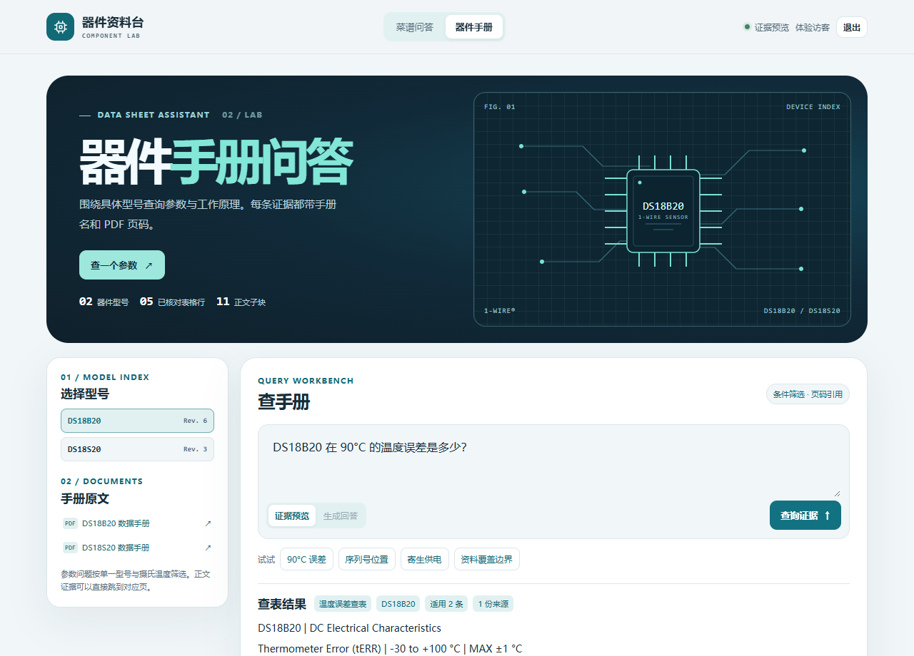
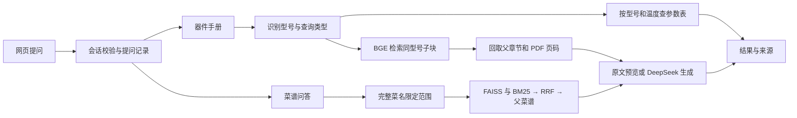

# 器件手册问答 · Electronics RAG Showcase

**用中文查询英文器件手册，沿 PDF 页码核对原文。** 同一演示附带菜谱 RAG 案例，展示如何从检索故障定位到元数据约束。

  

[快速运行](#快速运行) · [架构与案例](#架构与案例) · [评测复现](#评测复现) · [资料来源](THIRD_PARTY.md)

## 两个演示

<p>
  
  
</p>

| 入口 | 可以试的问题 | 页面展示 |
| --- | --- | --- |
| **器件手册** `/devices` | DS18B20 在 90°C 的温度误差是多少？ | ±1°C、适用温区和 PDF 第 2 页 |
| **器件手册** `/devices` | DS18S20 的唯一序列号保存在什么位置？ | 检索到手册第 5 页，可生成带页码的中文回答 |
| **菜谱问答** `/recipes` | 西红柿炒鸡蛋里一定要加入西葫芦吗？ | 按完整菜名限制检索，展开对应菜谱原文 |

证据预览和参数查表都在本机运行。生成中文回答时，后端才使用 DeepSeek。访客注册后可以在两页提问，本机管理员可查看注册和提问记录。

## 快速运行

以下命令在仓库根目录运行，已在 Windows、Python 3.12、CPU 环境验证。

```powershell
python -m venv .venv
.\.venv\Scripts\python.exe -m pip install torch==2.6.0 --index-url https://download.pytorch.org/whl/cpu
.\.venv\Scripts\python.exe -m pip install -r requirements.txt
.\.venv\Scripts\python.exe -X utf8 scripts/prepare_assets.py
.\.venv\Scripts\python.exe -X utf8 showcase/server.py
```

启动后打开 [器件手册](http://127.0.0.1:8765/devices) 或 [菜谱问答](http://127.0.0.1:8765/recipes)。首次访问时注册访客。第一次查正文会加载本地模型。第一次查菜谱会构建 FAISS 索引，后续启动可读盘复用。

如需生成回答，把 `.env.example` 复制为根目录下的 `.env`，在本机填入 `DEEPSEEK_API_KEY`，然后重启服务。器件终端脚本单独运行生成模式时，请把变量配置在当前环境或 `learning/.env`。

<details>
<summary>管理后台、临时公网与资料准备</summary>

**管理员**。执行 `.\.venv\Scripts\python.exe -X utf8 showcase/server.py --create-admin`，然后在服务运行时访问 [本机后台](http://127.0.0.1:8765/admin)。后台记录存于 `showcase/.data/showcase.sqlite3`，重启后可继续查看。密码以加盐哈希保存。

**临时公网**。安装 [cloudflared](https://developers.cloudflare.com/cloudflare-one/networks/connectors/cloudflare-tunnel/downloads/) 并将其放到系统路径，或者 Windows 下放入 `showcase/.runtime/cloudflared.exe`。关闭独立运行的本机服务，再执行 `.\.venv\Scripts\python.exe -X utf8 showcase/public_demo.py`。窗口会打印两个体验地址。公网只开放访客入口，后台需本机管理员登录。

**PDF 与模型**。准备脚本从 Analog Devices 下载已验证版本的 DS18B20（Rev. 6）和 DS18S20（Rev. 3），从 Hugging Face 准备 CPU Embedding 模型。也可手动从[资料出处](THIRD_PARTY.md)下载两份手册，保存为 `learning/迁移资料/DS18B20.pdf` 和 `learning/迁移资料/DS18S20.pdf`，再运行准备脚本校验版本并缓存模型。

</details>

## 架构与案例



- **器件问答**。pypdf 逐页读取，保留型号和 PDF 页序。正文在 11 个子块中检索，回取同型号章节。温度误差从五条人工核对记录筛选，输出适用条件及原始页码。
- **菜谱案例**。从 Markdown 标题切块，使用本地 FAISS、中文相邻二字 BM25 和 RRF。针对“西红柿炒鸡蛋一定要加西葫芦吗”这类干扰题，从原问题匹配完整菜名，在候选截断前限定检索范围。
- **运行范围**。器件正文包含两份手册的四个章节，使用进程内索引。参数覆盖已核对的温区。菜谱语料包含 323 个父文档。网页用 Python、HTML/CSS/JS 和 SQLite 实现。

## 评测复现

| 检查项 | 本地结果 |
| --- | ---: |
| 器件温度误差查表，含相似型号和边界 | 6/6 |
| 正文前三子块包含全部标注证据 | 1/4 |
| 回取父章节后包含全部标注证据 | 4/4 |
| 菜名过滤及生成入口本地回归 | 10/10 |

正文指标检查小型开发集的**证据覆盖**，生成答案另行人工核对。评测过程可以在本机运行，无需生成 API。

```powershell
.\.venv\Scripts\python.exe -X utf8 learning/11_electronics_vector_search.py --evaluate
.\.venv\Scripts\python.exe -X utf8 -m unittest discover -s learning -p test_c8_recipe_constraints.py
```

## 代码导览

| 目录 | 内容 |
| --- | --- |
| [showcase](showcase/) | Web 服务、页面、账户与临时公网启动 |
| [learning](learning/) | 器件检索与查表、菜谱对照实验、回归题集 |
| [code/C8](code/C8/) | 基于 Datawhale 第八章的菜谱 RAG |
| [data/C8/cook/dishes](data/C8/cook/dishes/) | 复现菜谱检索的 Markdown 语料 |
| [scripts](scripts/) | 从官方来源准备本地运行资料 |

项目署名和上游许可见[资料出处](THIRD_PARTY.md)与[许可](LICENSE)。
